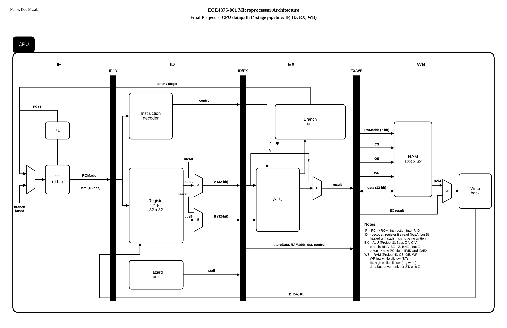

# Final Project — 4-Stage Pipelined 32-bit CPU

The Microarchitecture course final project: a working 32-bit CPU described in Verilog,
built up from the register file, ALU, and memory modules developed earlier in the course.
It fetches 49-bit instructions from a ROM, executes a four-stage pipeline with hazard
handling, and reads/writes a 32-bit RAM. A self-checking testbench runs the included
program and prints `PASS`/`FAIL` for every register and memory location it touches.



## Pipeline

| Stage | What happens |
|-------|--------------|
| **IF** | The program counter addresses the ROM; the 49-bit instruction is latched into IF/ID. |
| **ID** | The decoder splits the instruction and reads the two source registers; operands + controls go to ID/EX. |
| **EX** | The ALU computes the result and sets the flags; a branch is resolved here using the Z flag. |
| **WB** | The RAM is read or written and the register file is loaded. |

**Hazards** are handled with interlocks and flushes: an instruction in ID stalls while an
older instruction still in EX/WB will write a register it reads, and when a branch is taken
in EX the two younger instructions already in flight are replaced with NOPs and the PC takes
the target.

## Modules

| File | Module | Role |
|------|--------|------|
| `CPU.v` | `CPU` | Top-level pipelined datapath (includes `regFile.v`, `ALU.v`, `decoder.v`). |
| `ALU.v` | `ALU` | 32-bit arithmetic/logic unit with Z, N, C, V condition flags. |
| `regFile.v` | `regFile` | 32 × 32-bit register file. |
| `decoder.v` | `decoder` | Splits the 49-bit instruction and generates datapath control signals. |
| `ROM.v` | `ROM` | 64 × 49-bit instruction memory (holds the assembled `program.asm`). |
| `RAM.v` | `RAM` | 128 × 32-bit data memory with active-low CS/OE/WR and a tri-state bus. |
| `main_tb.v` | `main_tb` | Wires CPU + ROM + RAM, drives clock/reset, and self-checks every result. |
| `program.asm` | — | Test program: seeds registers, exercises every instruction and addressing mode, then tests the branches. |

## Instruction format

Every instruction is 49 bits, laid out as the course assembler (`CoolRISC_AssemblerV2`) builds it:

```
[48:44] opcode   [43:42] mode   [41:37] src   [36:32] dst   [31:0] literal
```

`mode` is `0` immediate, `1` direct (literal is a RAM address), `2` register.
Instructions: `LD`, `ST`, `ADD`, `SUB`, `NOT`, `XOR`, `AND`, `OR`, `SR`, `SL`, and the
branches `BZ`, `BNZ`, `BRA`.

## Build & simulate

Requires [Icarus Verilog](http://iverilog.icarus.com/) (`iverilog`/`vvp`) and, optionally,
GTKWave for the waveform.

```bash
iverilog -o cpu main_tb.v      # main_tb.v includes CPU.v, ROM.v, RAM.v
vvp cpu                        # runs program.asm and prints PASS/FAIL per check
gtkwave main_tb.vcd            # optional: inspect the waveform
```

## Documentation

- `datapath.png` / `datapath.pdf` — the CPU datapath diagram the pipeline is built from (shown above).
- `structure.png` — the top-level project structure (testbench wiring CPU, ROM, RAM and clock).
- `cpu_cpu.svg` — a synthesized schematic of the CPU (generated with Yosys/netlistsvg).

Compiled output (`*.out`, `*.vcd`, `build/`) is intentionally not committed — regenerate it
with the commands above.
